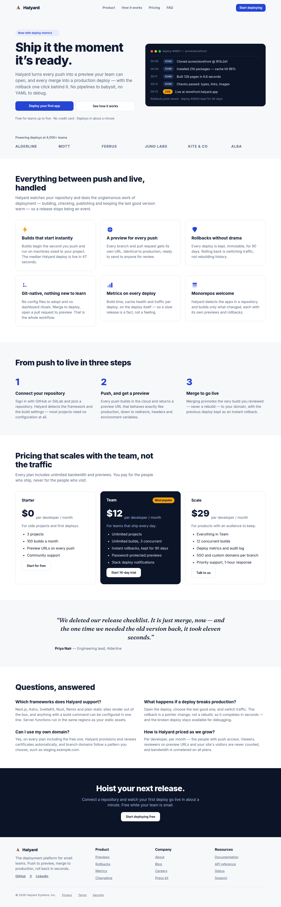
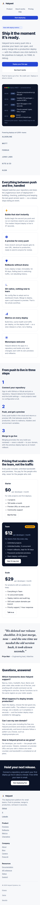

# Halyard — SaaS landing page

A complete landing page for **Halyard**, a fictional deployment platform for small teams: header, hero with a live deploy log, logo strip, features, how-it-works, pricing with a highlighted plan, testimonial, FAQ, closing call to action and footer. Built entirely with [Hyper Elements](https://hyperelements.dev) as a single `<Page>` template.





## Run it

```bash
npm install
npm run render     # validates, then writes out/index.html + out/index.txt
npm run check      # the Hyper Elements CLI check on the template
npm run preview    # screenshots the rendered page with headless Chromium (needs a Playwright Chromium build)
```

Open `out/index.html` in any browser. The page is one static HTML file — no client-side JavaScript, no external assets, nothing fetched at runtime.

**Checks:** `hyper-elements check` reports **0 errors, 0 warnings**. `validate()` inside `src/render.tsx` prints no diagnostics, and the rendered page loads with a clean console at desktop and phone widths.

## How Hyper Elements was used

- **One root, one file.** The whole page is a single `<Page>` template (`src/halyard.tsx`) rendered with `render()`. Bands are `<Section>`s whose backgrounds span the window; layout is `Row`, `Column` and `Grid`; there are no margins anywhere — spacing is each parent's `gap` and each box's `padding`, as the library intends.
- **A theme carries the brand.** `defineTheme` sets the color tokens (`primary`, `muted`, `border`, …), the Inter type stack, a three-level `Heading` type scale via `components.Heading.by.level`, `Button` defaults with `secondary` and `inverted` variants (picked up with `variant="…"`), and named `card` / `chip` styles reused through `style={{ apply: […] }}`. The featured pricing column inverts itself with a scoped `tokens` override instead of one-off styles.
- **Two typed custom components**, defined with `component()` and checked by `validate()` like the built-ins:
  - `halyard.LogLine` — a deploy-log line with a `done` / `live` status chip (`prop.choice`), which builds the hero's deploy log.
  - `halyard.Feature` — a feature card whose glyph (`bolt`, `shield`, `bars`, `stack`, `branch`, `globe`) is drawn with `Svg` shapes (`Polygon`, `Rect`) filled with theme tokens via `token("colors.primary")`.
- **Phones are designed, not shrunk.** Headings carry `mobile:` style blocks, sections swap in phone padding, rows stack — except the rows that must not (logo, log lines, price rows), which set `stackOnMobile={false}`.
- **The feedback loop the library is built for.** `src/render.tsx` runs `validate()`, prints `outline()` (the layout as text) and `formatDiagnostics()`, and only renders when the template is valid.

## Make it yours

- **Rebrand:** edit the `halyard` theme at the top of `src/halyard.tsx` — colors, fonts, the heading scale and button variants — and every section follows.
- **Change plans and features:** pricing plans and FAQ entries are plain data arrays in the same file; the sections map over them.
- **Reuse the components:** `LogLine` and `Feature` are ordinary exports of the template file; copy them into another template and they keep their prop checking.

## Files

- `src/halyard.tsx` — the template (theme, custom components, page)
- `src/render.tsx` — validate → outline → render to `out/`
- `scripts/screenshot.mjs` — headless-Chromium screenshots used for the previews above
- `preview.png`, `preview-mobile.png` — the rendered page at 1280px and 390px

MIT licensed.
